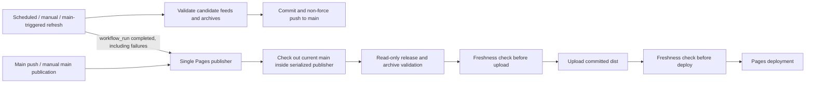

# Single-authority Pages publication and recovery

## Confirmed incident — 31 October 2026

Both workflows published their own `dist` artifact under different concurrency groups. Merge `674fa1e7209cc4caf8df724a9437f5b4bffa39f0` triggered both.

1. [Refresh run 41254137856](https://github.com/MediaCollectiveEvents/hammersmith-fulham-bird-board/actions/runs/41254137856) fetched that merge, updated/committed feeds as `9773f0de5a34fba6c00bd528a73c4b4d32af0563`, uploaded artifact **13062397987** at 23:50:06 and deployed it around 23:50:08–13 UTC.
2. [Pages run 41254137870](https://github.com/MediaCollectiveEvents/hammersmith-fulham-bird-board/actions/runs/41254137870) checked out the original event SHA at 23:50:17, uploaded artifact **13062527570** at 23:50:20 and deployed its older feed data around 23:50:21–26.
3. Both runs succeeded. The last artifact won, even though it contained older observations. Artifact ZIP/tar contents were independently inspected:

| File | Refresh artifact | Later, older Pages artifact |
|---|---|---|
| Borough observations | 23:50:01 UTC; 288 records | 10:59:14 UTC; 288 records |
| BirdWeather | 23:50:02 UTC; 241 detections | 10:59:15 UTC; 282 detections |
| WWT | 23:50:03 UTC; 753 records | 10:59:16 UTC; 705 records |

The refresh artifact digest is `sha256:1cd183c47d533b50e6694c172e32eaefd370cd358d022f3893b935a786f9455b`; the later Pages artifact is `sha256:3b7b473c7a2276a4cc3b22eca7fd724b54f1f76f6b2756e7481660cbd2282da0`. Public feed timestamps matched the latter. This is a publication race, not a service-worker cache problem.

The refresh pushed with `GITHUB_TOKEN`; such pushes do not normally trigger a second push workflow. See [GitHub's trigger documentation](https://docs.github.com/en/actions/how-tos/write-workflows/choose-when-workflows-run/trigger-a-workflow). There was consequently no later push deployment to repair the overwrite.

## New authority

Only `pages.yml` uses Pages artifact/deployment actions. Its global `pages` concurrency group has `cancel-in-progress: false`: a deployment already started is allowed to finish, and newer publication cannot race past it. Each run explicitly checks out **main at execution time**, not the SHA of an old triggering event. An old queued/manual/refresh-completion event therefore does not imply an old snapshot.

`check-publication-head.mjs` compares checked-out HEAD with `git ls-remote origin refs/heads/main` before upload and again before deployment. Missing/invalid/unreachable identities fail closed. A changed head produces `publish=false`, a clear summary and no deployment. The read-only existing validator checks metadata schema, READY release hashes, public images/assets and in-memory archive consistency before either fence; it does not regenerate feeds or archives.

A refresh that commits during validation/upload makes that candidate skip. A commit after the final fence, during an already-starting deployment, cannot retroactively stop that deployment safely. Instead, serialization prevents the older deployment from finishing **after a newer publication**, and the new main push/refresh-completion event queues a latest-main reconciliation. Once successful queued publications settle, the final artifact is current validated main. This is an eventual-convergence guarantee under successful event delivery and a reachable/valid main, not an impossible atomic lock between Git commits and the Pages API. Shared concurrency alone, or merely disabling cancellations, would not fix event-SHA checkout staleness.

### Refresh completion and security

The publisher listens to `workflow_run: completed` for `Update eBird observations`, restricted to this repository's main branch and push/schedule/manual refresh events. It runs on successful **and failed** completion, because valid successes may already have been committed before a partial failure. It never consumes upstream artifacts as executable code; it checks out trusted committed main. This follows [GitHub's workflow_run model](https://docs.github.com/en/actions/reference/workflows-and-actions/events-that-trigger-workflows#workflow_run) without requiring a PAT or extra dispatch token.

The refresh job has `contents: write` only, with no Pages or OIDC permissions and no Pages deployment action. Its existing `github-pages` environment is retained solely to avoid breaking any environment-scoped eBird secret; its URL/deployment-step reference is removed. The environment may still have a GitHub deployment record, but this job no longer publishes a Pages artifact.

Every pipeline retains its existing ingestion/identity/boundary/privacy logic. WWT failure no longer prevents successful borough/BirdWeather output from reaching candidate validation. Failed pipelines retain their previous snapshots. Candidate validation must pass before any combined refresh is committed. Partial failures are explicitly marked failed after preserving validated successes, rather than producing a misleading all-green refresh. Monthly archive failure that leaves an inconsistent candidate blocks that commit and publication.

Non-fast-forward pushes are rejected, never forced. If a code merge or other update wins while refresh is collecting, its collected files are retained in a named recovery artifact for seven days and the run fails visibly; they are not silently discarded or automatically overlaid onto newer data. A failed validation also retains candidate files for inspection; these are **not declared validated authoritative data**. Artifacts contain only the existing public-output files, not API payloads/credentials. Preserve/download them within retention and reconcile through the existing pipelines under review, rather than blindly restoring over newer main. Publication of already committed valid main still reconciles on the failed run's completion.

## Coverage and limits

`test/publication-order.test.mjs` covers:

- merge plus refresh starting together;
- refresh before queued publication;
- refreshed main during validation and artifact upload;
- second refresh and a commit just after the final fence;
- delayed/out-of-order older events and inability for two deploys to be active;
- failed/partial completion, invalid candidate and scheduled/manual completion paths;
- workflow wiring: sole publisher, both gates, non-cancelling serialization, trusted main filtering and retained failure candidates;
- real temporary Git origin: full identity comparison and CLI skip output when remote main advances, without changing the candidate checkout.

The discrete-event simulations use the production gate. They demonstrate ordering under the documented serialization/event-delivery assumptions; they do not claim to invoke real competing Pages deployments. PR CI runs them safely with no deployment permission. Existing dashboard/data tests and published-data validation also run. Production deploy/refresh/dispatch is deliberately **not** exercised before explicit release approval.

A failed validation, lost/delayed workflow event, unavailable remote, environment approval gate or failed deployment can delay convergence. Monitor failed/skipped publications and retry the sole publisher on main after review. A pending run may be replaced by another concurrency event; every surviving run chooses latest main, so arrival order does not create rollback. Force-pushes or intentional data reverts on main are outside this append-only trusted-main policy. No dashboard, observation schema, source timestamp, photo, taxonomy, privacy or archive contents changed in this fix.

## Recovery — requires explicit approval

At preparation, the latest authoritative committed feed snapshot is **9773f0de5a34fba6c00bd528a73c4b4d32af0563**, with the refreshed timestamps/counts in the table above. Its public release, hashes and two existing monthly archives validate. Use committed main as authority, not a live CDN file or an expiring artifact. Recheck main if newer refreshes arrive.

1. Review this PR and require green CI. Confirm no queued/in-progress run is still using the **old** dual-publisher definitions; let it finish or explicitly cancel it before authorizing this fix's merge. An already-running workflow keeps its old definition.
2. **Obtain explicit merge/publication approval.** Merging changes to main automatically triggers the new publisher and (because the refresh workflow changes) a refresh. Do not merge merely as a preparatory step while claiming it cannot republish.
3. The publisher validates and selects then-current main. The refresh commits validated updates and its completed event queues reconciliation through the same publisher. Wait for both; do not deploy the historical event SHA manually.
4. If recovery still needs a manual retry after the reviewed fix is on main, separately approve and dispatch **Deploy bird board to GitHub Pages** with ref **main**. Do not dispatch an old workflow/branch or upload the old artifact. A manual run is subject to the same latest-main validation and freshness gates.
5. Record the candidate SHA in the workflow summary, latest main SHA, artifact/deployment identity and each feed's live timestamp/hash after CDN propagation. Verify they match the final validated committed snapshot (or a newer validated one), plus monthly archives and core dashboard/PWA smoke checks.
6. Preserve previous main/release references for an explicitly reviewed rollback. Never manufacture records, advance timestamps to appear fresh, replace archives with rolling API output, force-push main, or copy an old feed snapshot over a newer commit.

No merge, deployment, refresh dispatch or recovery publication was performed while preparing this change.
